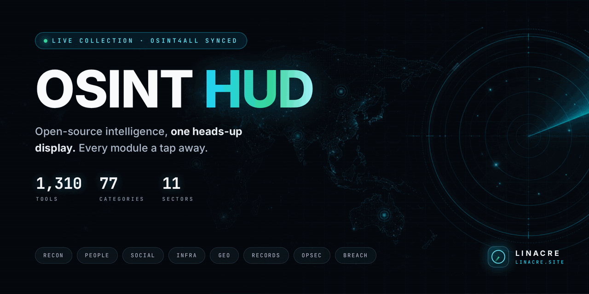
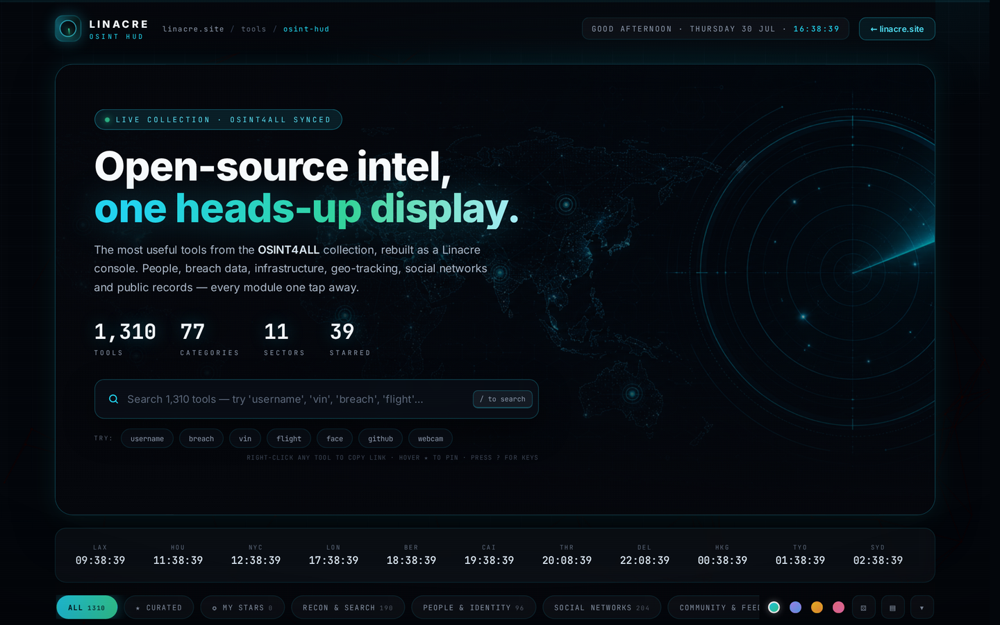
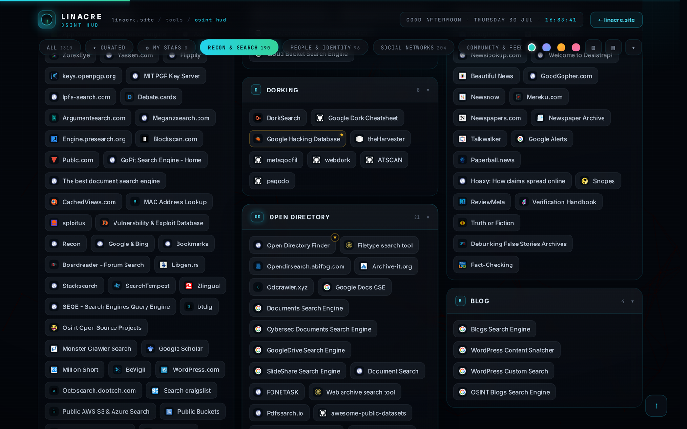

<p align="center">
  <a href="https://lin4cre.github.io/linacre-osint-hud/">
    
  </a>
</p>

<h1 align="center">🛰️ Linacre OSINT HUD</h1>

<p align="center">
  <strong>Open-source intelligence, one heads-up display.</strong><br>
  1,310 curated OSINT tools from the public <a href="https://start.me/p/L1rEYQ/osint4all">OSINT4ALL</a> collection,<br>
  rebuilt as a fast, animated, dark-glass console — part of <a href="https://www.linacre.site/">linacre.site</a>.
</p>

<p align="center">
  <a href="https://lin4cre.github.io/linacre-osint-hud/"></a>
  
  
  
  
</p>

---

## ▶ Live demo

**https://lin4cre.github.io/linacre-osint-hud/**

No install, no account, no backend — one self-contained `index.html` you can also download and open locally.

<p align="center">
  
</p>

---

## ⌖ What's inside

The entire worthwhile contents of the [OSINT4ALL](https://start.me/p/L1rEYQ/osint4all) start.me page
(its **77 link widgets, world-clock config and Reddit intel feed**), health-checked, de-duplicated,
dead links removed — grouped into **11 sectors**:

| Sector | Covers |
|---|---|
| 🔍 **Recon & Search** | Unified search, 60+ engines, Google CSEs, dorking, open directories, datasets, source-code & news search |
| 🧑 **People & Identity** | People search, username hunters (Sherlock, Maigret, WhatsMyName), email & phone tooling |
| 💬 **Social Networks** | Twitter/X, Reddit, Instagram, Telegram, Discord, YouTube, TikTok & 10 more platforms |
| 🗞️ **Community & Feeds** | Live OSINT subreddit multifeed + research communities |
| 🖼️ **Media & Files** | Reverse image, face search, forensics, EXIF, downloaders |
| 🌐 **Infra & Cyber** | Shodan, GreyNoise, crt.sh, DNS, Whois, threat maps, malware sandboxes, IoT cams |
| 🛰️ **Geo & Tracking** | Maps, flights (ADS-B), maritime AIS, VIN/plates, radio/wifi (WiGLE) |
| 💰 **Money & Business** | Crypto tracing, finance, company registries (OpenCorporates, Companies House) |
| 🗄️ **Records & Intel** | Court/public records, government data, LE databases, voter rolls, breach dumps, darknet |
| 🕶️ **Opsec & Cover** | Privacy guides, secure comms, burner contacts, identity generators, sandboxes |
| 🧰 **Toolkit & Resources** | CyberChef, hash recovery, productivity utilities, OSINT frameworks & blogs |

---

## ✨ Feature highlights

**Console experience**
- Terminal **boot sequence** (once per session, click/any key to skip)
- Animated **particle-network canvas**, radar hero artwork, scanlines, staggered reveals
- **12 Tier-1 priority modules** — 3D tilt, cursor-tracked glow, hand-written summaries
- Live **world-clock array (11 investigator time zones)** lifted straight from the source page
- Greeting clock, count-up stats, scroll progress bar, custom dark scrollbar

**Quality of life**
- 🔎 **Live search** across 1,310 titles, hosts & categories — `/` to focus, `Enter` opens first hit, `Esc` clears
- ⭐ **My Stars** — pin your own favourites (persisted in `localStorage`)
- 🕑 **Recent Ops strip** — last 14 tools you opened, always one click away
- 🔗 **Right-click any tool** to copy its link, with toast feedback
- ⚄ **Random Op** button — jump somewhere new in the visible set
- 🎨 **4 accent themes** (cyan / violet / amber / rose) + **compact density** toggle
- #️⃣ **Shareable searches** — query & sector sync to the URL hash (`#q=vin&g=geo`)
- ⧉ Per-sector copyable anchor links, collapsible panels, expand/collapse-all
- ⌨️ Keyboard map on `?`, scroll-spy chips, suggestion chips, `<noscript>` fallback

**Modern CSS4 / progressive enhancement**
`@property` animated conic sweeps · `color-mix()` theming · `:has()` state styling ·
native **CSS nesting** · container queries · `animation-timeline: view()/scroll()` scroll-driven effects ·
**View Transitions API** filter crossfades · `content-visibility` render optimisation ·
`text-wrap: balance` · full `prefers-reduced-motion` support

**Performance & privacy**
- Zero dependencies, zero build step, zero tracking — fonts & favicons are the only external calls
- Lazy favicons with monogram fallback; panels skip off-screen rendering via `content-visibility`
- Stars, recents, theme & density live only in your browser — **nothing is uploaded**

<p align="center">
  
</p>

---

## ⌨ Keyboard ops

| Key | Action |
|---|---|
| `/` | Focus search |
| `Enter` | Open first match |
| `Esc` | Clear search / close panels |
| `?` | Shortcuts overlay |
| right-click | Copy a tool's link |
| hover `★` | Pin / unpin a tool |

---

## 🚀 Run it yourself

```bash
git clone https://github.com/LIN4CRE/linacre-osint-hud.git
cd linacre-osint-hud
open index.html        # or just double-click it — no server needed
```

Deploy your own copy anywhere static: GitHub Pages, Cloudflare Pages, Netlify, S3…
It's one HTML file plus `img/` — that's the whole thing.

## 🔧 Rebuild / re-curate

The dataset was extracted from the public OSINT4ALL page (archived JSON snapshot) and cleaned
with Python. To re-curate the tiers or regenerate the page:

```bash
python3 build.py       # renders index.html from osint_grouped.json
```

- `PRIME` / `STARRED` sets and sector mapping live at the top of `build.py`
- Raw source dump: `osint4all.json` · cleaned: `osint_clean.json` · grouped: `osint_grouped.json`

## 📁 Repo layout

```
linacre-osint-hud/
├── index.html             # the HUD — self-contained console (built)
├── build.py               # generator / curation pipeline
├── img/radar-hero.png     # hero artwork
├── assets/                # README banner (+ its source frame)
├── docs/                  # README screenshots
├── osint4all.json         # raw archive of the source page
├── osint_clean.json       # health-checked links
└── osint_grouped.json     # final 11-sector dataset
```

---

## ⚖️ Disclaimer

This is a **link directory**: all tools are external third-party sites under their own terms and
privacy policies, curated from the public OSINT4ALL collection for lawful research, journalism,
security and due-diligence work. Always respect privacy and the law in your jurisdiction.

## 🙏 Credits

- **OSINT4ALL** — the original collection: <https://start.me/p/L1rEYQ/osint4all>
- **Linacre** — design & build: <https://www.linacre.site/>

<p align="center">
  <sub>© 2026 Linacre · Built in Liverpool, UK · MIT License</sub>
</p>
